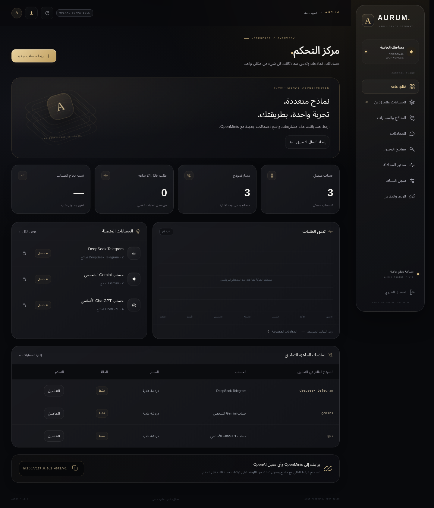

# AURUM Proxy

بروكسي متعدد الحسابات متوافق مع واجهتَي OpenAI Chat Completions وResponses، مع لوحة إدارة عربية بخلفية سوداء ونصوص بيضاء ولمسات ذهبية. يدعم حسابات **ChatGPT وGemini وDeepSeek Telegram وQwen**.



## ما الذي أُنجز؟

1. **المزوّدون والبروتوكولات:** اكتشاف النماذج والمحادثات من الحساب، مشاريع ChatGPT ومحادثات كل مشروع، استمرار السياق، رفع الملفات، معالجة أخطاء الخدمة والردود غير المكتملة، وإصلاح مسارات Qwen الأصلية.
2. **لوحة التحكم:** الحسابات وتحديث التوكن/الكوكيز، المشاريع والمحادثات بقوائم اختيار، إعدادات التفكير والبحث بحسب المزوّد، مسارات مستقلة لكل مهمة، مفاتيح التطبيقات وصلاحياتها، المحادثات المحلية، مختبر محادثة وسجل الطلبات.
3. **التوافق والاختبارات:** OpenAI SDK الرسمي، بروتوكول OpenMinis المفتوح المصدر، اختبارات API واختبارات واجهة Chromium وWebKit بحجم iPhone، واختبار حساب Gemini حقيقي.

تُلصق بيانات الدخول مرة واحدة؛ لا تحتاج كتابة معرف الحساب أو النموذج أو المشروع أو المحادثة. تُجلب هذه القوائم من الخدمة. الميزات المتاحة تعتمد على الحساب وما يعلنه المزوّد؛ مثلًا لا تُعرض مشاريع وهمية لـGemini.

## التشغيل

يتطلب Python 3.12+. لا يحتاج Node للتشغيل؛ ملفات اللوحة جاهزة.

```bash
python -m venv .venv
source .venv/bin/activate
pip install -r requirements.txt
cp .env.example .env
```

ضع كلمة مرور إدارة قوية من 12 حرفًا على الأقل في `.env`، ثم:

```bash
uvicorn qwen_proxy:app --host 0.0.0.0 --port 8000 --workers 1 --env-file .env
```

افتح `http://localhost:8000`، وسجّل الدخول، ثم:

1. أضف الحساب واختر المزوّد والصق توكن الجلسة؛ لـGemini الصق ترويسة كوكيز Google الكاملة. قالب ChatGPT يستخدم توكن حساب الويب، وليس مفتاح OpenAI API.
2. بعد الربط اختر النموذج والمشروع وسلوك المحادثة من القوائم. اختيار مشروع ChatGPT مع الوضع التلقائي يجعل المحادثات الجديدة تُنشأ داخل ذلك المشروع.
3. من «النماذج والمسارات» أنشئ أسماء مستقلة مثل `translation` و`terminology` و`review`، واربط كل اسم بحساب أو مشروع أو محادثة مختلفة، أو اتركه يرث إعدادات الحساب.
4. أنشئ مفتاحًا من «مفاتيح الوصول» وحدد النماذج المسموحة. يُعرض المفتاح كاملًا مرة واحدة.

لتحديث بيانات دخول حساب موجود افتح «إدارة الحساب ← تحديث التوكن أو الكوكيز». يبقى الحساب ومساراته ومفاتيح العملاء، وتُمسح روابط السياق والملفات والمشاريع القديمة؛ اخترها مجددًا بعد الربط.

## الربط مع OpenMinis والتطبيقات المشابهة

في إعدادات موفّر OpenAI المتوافق:

| الإعداد | القيمة |
| --- | --- |
| Base URL | `https://YOUR-HOST/v1` |
| API key | مفتاح `sk-proxy-…` المنشأ من اللوحة |
| Model | اجلب القائمة واختر اسم المسار الذي أعددته |
| API | Chat Completions، أو Responses إذا اخترته صراحة |

لا تضف `/chat/completions` إلى Base URL. تطبيق OpenMinis يضيف المسار تلقائيًا. راجع [تفاصيل التوافق والحدود](docs/COMPATIBILITY.md).

```bash
curl https://YOUR-HOST/v1/chat/completions \
  -H "Authorization: Bearer $PROXY_API_KEY" \
  -H 'Content-Type: application/json' \
  -d '{"model":"gpt","messages":[{"role":"user","content":"مرحبا"}],"stream":true}'
```

كل بداية محادثة جديدة في العميل تنشئ محادثة بعيدة جديدة في الوضع التلقائي. تُستأنف المتابعات بمطابقة التاريخ الكامل، ضمن المفتاح والحساب والمشروع. يمكن للعملاء الذين يدعمون ذلك إرسال `X-Conversation-ID` لضبط الربط صراحة. التاريخ المتطابق بين محادثتين يُعامل بحذر بإنشاء سياق جديد بدل دمجهما خطأ. الوضع الثابت يشارك المحادثة المختارة عمدًا، والوضع «كل طلب مستقل» لا يستأنف السياق.

## Gemini والفصول الطويلة

وضع الفقرات **خاص بـGemini، قابل للتفعيل والتعطيل، ومعطّل افتراضيًا**. لا يؤثر في ChatGPT أو DeepSeek أو Qwen، ولا في محادثات Gemini العامة.

لتفعيله: فعّل المفتاح من إعدادات حساب Gemini، وأنشئ مسارًا بمهمة «ترجمة». يقسّم هذا المسار النص إلى دفعات مع علامات تغطية، ثم يتحقق من اكتمالها ويزيل العلامات. عند فشل التحقق يُرجع خطأ بدل حفظ نتيجة ناقصة. إيقاف المفتاح يعيد إرسال النص بالطريقة العادية. هذا فحص بنيوي، وليس ضمانًا لجودة الترجمة الدلالية.

## Docker والاستضافة

```bash
docker compose up --build -d
```

يقرأ Compose كلمة المرور من `.env` ويستخدم volume لحفظ البيانات. يوجد أيضًا `Procfile` لمنصات تشغيل Python التي تضبط `$PORT`.

- شغّل **عاملًا واحدًا ونسخة واحدة**؛ أقفال المحادثات وحدود الطلبات داخل العملية، والتخزين SQLite محلي.
- اضبط `DATA_DIR` على قرص دائم. احتفظ بنسخة احتياطية من **المجلد كله، بما فيه `vault.key` وملفات SQLite**، أو ثبّت `VAULT_KEY` في أسرار الاستضافة. فقد مفتاح التشفير يمنع استعادة بيانات الحسابات.
- استخدم HTTPS في الاستضافة واضبط `COOKIE_SECURE=true`. اتركه `false` للتطوير المحلي عبر HTTP.
- ملف `.env` والبيانات والتوكنات مستبعدة من Git ومن صورة Docker. لا توجد بيانات دخول المستخدم داخل المستودع.

عند النشر على Railway اختر `Dockerfile.railway` للبناء، واربط volume بالمسار `/data`، واضبط `RAILWAY_RUN_UID=0` لصلاحيات الكتابة على قرص Railway، إضافة إلى كلمة مرور الإدارة و`COOKIE_SECURE=true`. ملف البناء هذا لا يتطلب secret mounts التي لا يدعمها Metal builder.

الحسابات والملفات وحالة المحادثة وبيانات Responses مخزنة بتشفير Fernet، ومفاتيح العملاء مخزنة كبصمات SHA-256. سجل النشاط لا يخزن نصوص الرسائل أو التوكنات. بيانات النماذج وعناوين المحادثات المكتشفة تُحفظ كبيانات وصفية محلية.

## الاختبارات والمصادر

انظر [الاختبارات ونتائجها وحدود التحقق](docs/TESTING.md)، و[تحليل المشروع الأصلي ومصادر البروتوكولات](docs/SOURCE_REVIEW.md). بروتوكولات حسابات الويب قابلة للتغيير من الشركات؛ اتصال حساب حقيقي مطلوب للتحقق من صلاحياته الحالية. لم يُنشر هذا المستودع تلقائيًا على خدمة استضافة.
